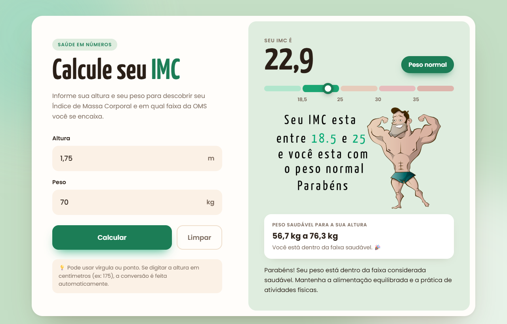
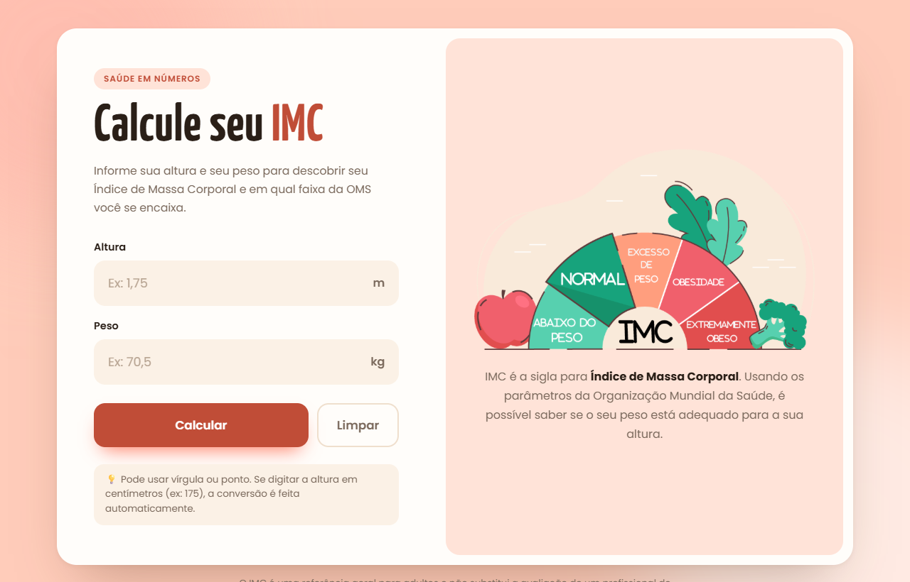
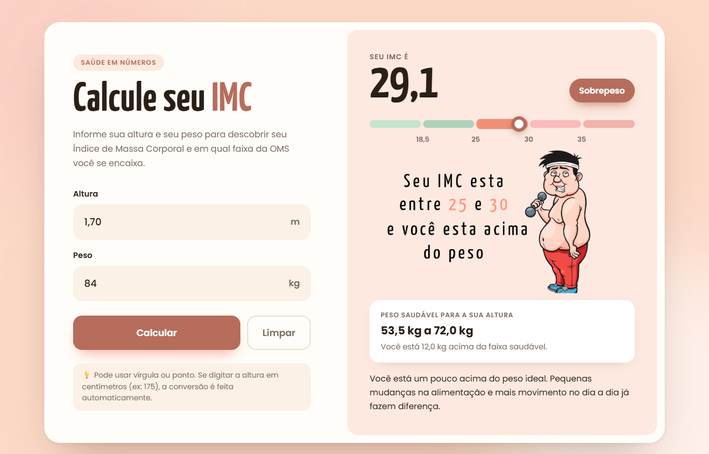
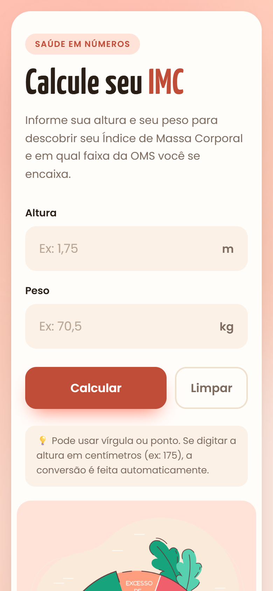
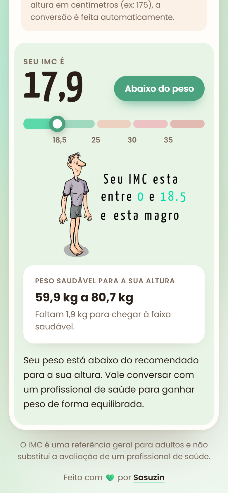

<div align="center">

# ⚖️ Calculadora de IMC

**Descubra seu Índice de Massa Corporal, veja em qual faixa da OMS você está e qual é o peso saudável para a sua altura.**

<br>

[](https://sasuzin.github.io/Calculadora-de-IMC/)


<br>



</div>

---

## 📌 Sumário

- [Sobre o projeto](#-sobre-o-projeto)
- [Funcionalidades](#-funcionalidades)
- [Telas](#️-telas)
- [Como o IMC é calculado](#-como-o-imc-é-calculado)
- [Tecnologias](#️-tecnologias)
- [Estrutura de pastas](#-estrutura-de-pastas)
- [Como executar](#-como-executar)
- [O que mudou na versão 2.0](#-o-que-mudou-na-versão-20)
- [Como contribuir](#-como-contribuir)
- [Autor](#-autor)

---

## 💡 Sobre o projeto

O **IMC (Índice de Massa Corporal)** é uma medida usada pela **Organização Mundial da Saúde (OMS)** para avaliar se o peso de uma pessoa adulta está adequado para a sua altura.

Este projeto é uma calculadora de IMC feita com **HTML, CSS e JavaScript puro**, sem frameworks e sem bibliotecas. A pessoa informa altura e peso e, na hora, recebe:

- o valor do IMC;
- a classificação segundo a OMS;
- a faixa de **peso saudável** para a sua altura;
- quantos quilos faltam ou sobram para chegar nessa faixa;
- uma ilustração e uma mensagem de acordo com o resultado.

O site inteiro **muda de cor** conforme a faixa do resultado, deixando a informação visual e fácil de entender.

---

## ✨ Funcionalidades

| | Funcionalidade | Descrição |
|---|---|---|
| 🧮 | **Cálculo instantâneo** | Calcula o IMC com uma casa decimal, igual à tabela da OMS. |
| 🏷️ | **Classificação OMS** | Mostra se o resultado é *abaixo do peso*, *normal*, *sobrepeso*, *obesidade* ou *obesidade grave*. |
| 📊 | **Barra de escala** | Uma barra colorida com um marcador animado mostra exatamente onde o seu IMC está. |
| 🎯 | **Peso saudável** | Calcula a faixa de peso ideal para a sua altura e quanto falta (ou sobra) para chegar nela. |
| 🎨 | **Tema dinâmico** | Fundo, botões e destaques mudam de cor de acordo com a faixa do resultado. |
| ✍️ | **Entrada flexível** | Aceita vírgula ou ponto (`1,75` ou `1.75`), unidades (`70 kg`) e até altura em centímetros (`175`). |
| ✅ | **Validação amigável** | Campos vazios ou valores impossíveis mostram uma mensagem clara embaixo do campo. |
| ⌨️ | **Atalho no teclado** | É só apertar **Enter** para calcular. O botão **Limpar** volta tudo ao início. |
| 📱 | **Responsivo** | Funciona bem no computador, tablet e celular. No celular, a tela rola sozinha até o resultado. |
| ♿ | **Acessível** | Labels nos campos, mensagens de erro lidas por leitores de tela e respeito à preferência de *movimento reduzido*. |

---

## 🖼️ Telas

### 💻 Computador

<table>
  <tr>
    <td align="center"><b>Tela inicial</b></td>
    <td align="center"><b>Resultado: sobrepeso</b></td>
  </tr>
  <tr>
    <td></td>
    <td></td>
  </tr>
</table>

### 📱 Celular

<p align="center">
  
  &nbsp;&nbsp;&nbsp;
  
</p>

---

## 🧮 Como o IMC é calculado

A fórmula é simples: o **peso** (em kg) dividido pela **altura** (em metros) ao quadrado.

```
IMC = peso ÷ (altura × altura)
```

> **Exemplo:** uma pessoa com **1,75 m** e **70 kg**
> `70 ÷ (1,75 × 1,75) = 70 ÷ 3,0625 =` **22,9** → *Peso normal* ✅

### Tabela de classificação (OMS)

| Faixa | IMC | Cor no site |
|---|---|---|
| Abaixo do peso | menor que **18,5** |  |
| Peso normal | de **18,5** a **24,9** |  |
| Sobrepeso | de **25,0** a **29,9** |  |
| Obesidade | de **30,0** a **34,9** |  |
| Obesidade grave | **35,0** ou mais |  |

### Peso saudável para a sua altura

A faixa de peso saudável é calculada "ao contrário", usando os limites do IMC normal:

```
peso mínimo = 18,5 × altura²
peso máximo = 24,9 × altura²
```

Para **1,75 m**, por exemplo, o peso saudável vai de **56,7 kg** a **76,3 kg**.

> [!NOTE]
> O IMC é uma referência geral para **adultos** e não leva em conta massa muscular, idade, sexo ou distribuição de gordura. Ele **não substitui** a avaliação de um profissional de saúde.

---

## 🛠️ Tecnologias

| Tecnologia | Uso no projeto |
|---|---|
| **HTML5** | Estrutura semântica da página e formulário acessível. |
| **CSS3** | Layout com Grid e Flexbox, variáveis CSS, `color-mix()` para o tema dinâmico, animações e media queries. |
| **JavaScript (ES6+)** | Leitura e validação dos campos, cálculo do IMC, classificação e atualização da tela. |
| **Google Fonts** | Fontes [Poppins](https://fonts.google.com/specimen/Poppins) e [Yanone Kaffeesatz](https://fonts.google.com/specimen/Yanone+Kaffeesatz). |
| **GitHub Pages** | Hospedagem do site. |

---

## 📁 Estrutura de pastas

```
Calculadora-de-IMC/
├── 📄 index.html            → estrutura da página
├── 📂 CSS/
│   ├── style.css            → estilos principais e tema dinâmico
│   └── responsivo.css       → ajustes para tablet e celular
├── 📂 JS/
│   └── index.js             → validação, cálculo e exibição do resultado
└── 📂 Imagens/
    ├── tela principal.png   → ilustração da tela inicial
    ├── magro.png            → abaixo do peso
    ├── peso-ideal.png       → peso normal
    ├── acima do peso.png    → sobrepeso
    ├── gordo.png            → obesidade
    ├── obeso.png            → obesidade grave
    └── 📂 readme/           → capturas de tela usadas neste README
```

---

## 🚀 Como executar

O projeto não precisa de instalação nem de build. Escolha uma das opções:

### 🌐 Opção 1: acessar online

👉 **[sasuzin.github.io/Calculadora-de-IMC](https://sasuzin.github.io/Calculadora-de-IMC/)**

### 💻 Opção 2: rodar no seu computador

```bash
# 1. Clone o repositório
git clone https://github.com/Sasuzin/Calculadora-de-IMC.git

# 2. Entre na pasta
cd Calculadora-de-IMC
```

Depois é só abrir o `index.html` no navegador, ou subir um servidor local:

```bash
# Com Python
python -m http.server 5500

# ou com Node.js
npx serve .
```

E acessar **http://localhost:5500** no navegador.

> 💡 No VS Code, a extensão **Live Server** também funciona: clique com o botão direito no `index.html` e escolha *Open with Live Server*.

---

## 🔄 O que mudou na versão 2.0

A primeira versão (2022) tinha alguns problemas que faziam a calculadora **não responder** em certos casos. Todos foram corrigidos:

### 🐛 Correções

- **Faixas com buracos:** valores como `24,95`, `30,05`, `35,05` ou acima de `99` não caíam em nenhuma faixa, e nada acontecia ao clicar em *Calcular*. Agora as faixas são contínuas e qualquer valor válido tem resultado.
- **Campos vazios:** peso vazio dava IMC `0` e mostrava "magro"; altura vazia não fazia nada. Agora aparece uma mensagem pedindo o valor.
- **Altura em centímetros:** digitar `175` dava um IMC de `0,002` ("magro"). Agora é convertido para `1,75 m` automaticamente.
- **Cliques acumulados:** cada clique adicionava um novo *listener* ao botão, fazendo o cálculo rodar várias vezes. Agora o formulário tem um único evento.
- **Resultado escondido:** o valor do IMC nunca era mostrado na tela, só a imagem. Agora ele aparece em destaque.

### ✨ Novidades

- Visual totalmente redesenhado, com tema que muda de cor conforme o resultado
- Barra de escala com marcador animado
- Faixa de peso saudável e quanto falta ou sobra para chegar nela
- Aceita vírgula, ponto e unidades (`kg`, `cm`, `m`)
- Validação com mensagens claras, botão **Limpar** e cálculo com **Enter**
- Melhorias de acessibilidade e layout mobile revisado

---

## 🤝 Como contribuir

Contribuições são muito bem-vindas! 💚

1. Faça um **fork** do projeto
2. Crie uma branch para sua melhoria: `git checkout -b minha-melhoria`
3. Faça o commit: `git commit -m "Adiciona minha melhoria"`
4. Envie para o seu fork: `git push origin minha-melhoria`
5. Abra um **Pull Request**

Ideias de melhorias: histórico de cálculos, modo escuro, versão em inglês ou cálculo de IMC infantil (que usa curvas por idade).

---

## 👨‍💻 Autor

<table>
  <tr>
    <td align="center">
      <a href="https://github.com/Sasuzin">
        <br>
        <sub><b>Luís Felipe Galvão</b></sub>
      </a>
      <br>
      <a href="https://github.com/Sasuzin">@Sasuzin</a>
    </td>
  </tr>
</table>

<div align="center">

<br>

Feito com 💚 e JavaScript puro.<br>
Se este projeto te ajudou, deixe uma ⭐ no repositório!

</div>
